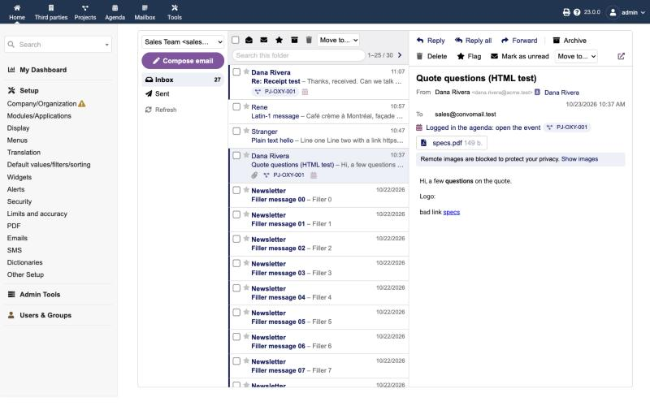
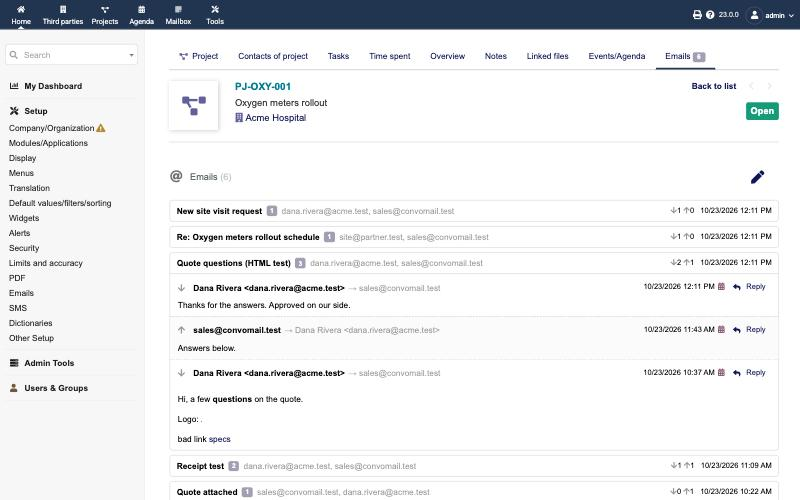

# Convomail — Dolibarr Module

Convomail lets each Dolibarr user send email from inside Dolibarr through their own mailbox. Every message is logged on the agenda of the customer, contact and project it belongs to. Users stop leaving Dolibarr to write email in another client, and the conversation history stays where the sales work happens.

**Status:** version 0.8.2: send and log, read receipts, a three-pane mailbox with conversations, AI writing tools, email on projects (Emails tab, suggestions, replies logged automatically through Dolibarr's Email Collector), rich-text compose with signature and templates, sign-in with Google or Microsoft 365 (OAuth), and shared mailboxes. Tested on Dolibarr 23.0 with PHP 8.2 against GreenMail and Dovecot test servers, including OAuth sign-in against a local token check. Not yet tested against real Gmail or Microsoft 365 servers.



**Download:** [latest release](https://github.com/zacharymelo/convomail/releases/latest) (`module_convomail-<version>.zip`, includes the IMAP library).

## Contents

- [What it does](#what-it-does)
- [How it works](#how-it-works)
- [Requirements](#requirements)
- [Installation](#installation)
- [Configuration](#configuration)
- [Sign in with Google or Microsoft 365](#sign-in-with-google-or-microsoft-365)
- [Using it](#using-it)
- [The mailbox](#the-mailbox)
- [Email on projects](#email-on-projects)
- [Composing](#composing)
- [Which email account is used](#which-email-account-is-used)
- [Read receipts and open tracking](#read-receipts-and-open-tracking)
- [Log replies automatically](#log-replies-automatically)
- [Shared mailboxes](#shared-mailboxes)
- [Replies and the Email Collector](#replies-and-the-email-collector)
- [Privacy and security notes](#privacy-and-security-notes)
- [What the module stores](#what-the-module-stores)
- [Upgrading](#upgrading)
- [Optional core patch](#optional-core-patch)
- [Roadmap](#roadmap)
- [Development](#development)
- [Repository layout](#repository-layout)
- [Licence](#licence)

## What it does

- **Mail accounts per user.** A **Mail accounts** tab on each user card holds that user's IMAP and SMTP settings. It has presets for Gmail and Microsoft 365, a connection test and Sent folder detection.
- **Compose from where you work.** An **Email from my mailbox** button on third party, contact and project cards opens a compose page with the recipient, third party and project filled in. **Agenda → Compose email** opens a blank one.
- **Reply from the agenda.** Any email event with a Message-ID gets a **Reply** button. The reply keeps the thread (In-Reply-To and References) and inherits the third party and project.
- **Sent through the user's own server.** Mail goes out through the user's SMTP account, so it passes SPF/DKIM for their domain.
- **Copy in the Sent folder.** A copy is stored in the user's IMAP Sent folder, so it also shows in their usual mail client. The Sent folder is detected automatically, and created if the server has none. If the copy fails, the email is still sent and logged, and the user sees a warning.
- **Logged to the agenda.** Each sent message becomes a "Send Email" (`AC_EMAIL`) event with subject, body, recipients and attachments.
  - It is linked to the third party, every recipient who is a known contact, the project and the originating document.
  - It appears on the existing conversation views of third parties, contacts and projects.
- **Read receipts and open tracking.** Ask for a standard read receipt on any message. Optionally (off by default) track opens with an invisible image; the first open adds an "Email opened" event to the timeline.
- **A mailbox inside Dolibarr.** A **Mailbox** tab in the top menu opens a three-pane mailbox (folders, messages, reading pane) with the usual actions and keyboard shortcuts.
- **Email on projects.** Each project gets an **Emails** tab with its threads. The mailbox shows which project a message belongs to, files replies to project threads automatically, and logs any message to a project in one click.
- **Rich-text compose.** Formatting, your signature, Dolibarr email templates, pasted images, and the project's contacts one click away.

## How it works

```
Compose page ──> ConvomailTransport ──> user's SMTP server ──> recipients
                        │
                        ├──> user's IMAP server: copy to Sent (same Message-ID)
                        │
                        └──> ConvomailMatcher (recipients → contacts, third party)
                                   │
                                   └──> ConvomailLogger ──> AC_EMAIL agenda event
                                                          + llx_convomail_message link
```

- **Sending** uses Dolibarr's own `CMailFile` with a dedicated `convomail` send context. The user's SMTP settings are put in memory for that one send and never written to the global configuration.
- **IMAP** goes through [bytestream/horde-imap-client](https://packagist.org/packages/bytestream/horde-imap-client), the IMAP stack Nextcloud Mail uses. It sits behind an interface so a JMAP client can be added later.

## Requirements

| Item | Version |
|---|---|
| Dolibarr | 20.0 or later (tested on 23.0) |
| PHP | 8.1 or later |
| Core modules | Third parties, Agenda, FCKeditor (enabled automatically with Convomail); Projects optional |
| Mail account | IMAP and SMTP access with a password or app password, or sign-in with Google or Microsoft 365 (OAuth, see [below](#sign-in-with-google-or-microsoft-365)). |

## Installation

1. Download `module_convomail-<version>.zip` from the [releases](https://github.com/zacharymelo/convomail/releases).
2. In Dolibarr, go to **Home → Setup → Modules → Deploy external module** and upload the zip.
3. Enable **Convomail** in the module list.
4. Give users the rights they need under **Users → Permissions → Convomail**:
   - *Use and manage own mail accounts*
   - *Send email from Dolibarr*
   - *Manage the mail accounts of all users* (for admins who set accounts up for others)

Enabling the module activates the core "Send Email" event type and adds an index on `llx_actioncomm.email_msgid`.

**"Failed to write in directory …/custom" when uploading the zip:** Dolibarr refuses online installs when the web server user cannot write to the `htdocs/custom` folder (it checks this before reading the zip). Give that folder to the web server user, for example:

```bash
ls -ld /var/www/html/custom
sudo chown -R www-data:www-data /var/www/html/custom
sudo chmod u+w /var/www/html/custom
```

With Docker, run it inside the container (`docker exec -u root <container> chown -R www-data:www-data /var/www/html/custom`), and if `custom` is a mounted folder, change ownership on the host side. Or install by hand: unzip the release into `htdocs/custom/` (it creates `custom/convomail/`), then enable the module.

## Configuration

Go to **Home → Setup → Modules → Convomail → Setup** (or **Home → Setup → Emails → Convomail** with the [optional core patch](#optional-core-patch)):

| Setting | Purpose |
|---|---|
| Allowed mail servers | One host per line, `*` as wildcard. When empty, any public server is allowed and private, loopback and reserved addresses are refused, so the server cannot be pointed at internal hosts. Add your internal mail server here if you use one. |
| Accept self-signed certificates | For internal SMTP servers you trust. |
| File replies to project threads automatically | On by default. See [Email on projects](#email-on-projects). |
| Add the user's signature | On by default. Inserts the signature from the user card when composing. |
| Request read receipts by default | Ticks "Request a read receipt" on the compose page. Users can untick it per message. |
| Open tracking | Off by default. Adds an invisible image to sent messages and logs opens. See [Read receipts and open tracking](#read-receipts-and-open-tracking) before enabling. |
| Debug Mode | Enables `/custom/convomail/ajax/debug.php` for admins. While it is on, each user's exchanges with their mail server are also recorded (passwords masked, but message text included), and `ajax/debug.php?mode=imaptrace` shows your last 8 requests. Turn it off when done. |

The same page has **Sign in with Google / Microsoft 365**: see [the next section](#sign-in-with-google-or-microsoft-365).

Each user then adds an account: **user card → Mail accounts → Add a mail account**, choosing a **Sign-in method**: a password, or Google / Microsoft 365 when the admin has set them up. With a password on Gmail, use an app password. The Gmail and Microsoft 365 presets tick **Server saves sent mail itself**, because those servers keep their own copy of what you send; for other servers leave it unticked so Convomail stores the copy.

## Sign in with Google or Microsoft 365

Users can connect a Google or Microsoft 365 mailbox without giving Dolibarr a password. They sign in on the provider's page, and Dolibarr gets a token that lets it read and send their mail. This is needed for Microsoft 365 tenants that block password login, and it avoids Gmail app passwords.

The admin sets up each provider once.

**1. Register an app at the provider**

*Google* (Google Cloud console → APIs & Services):
1. Configure the OAuth consent screen. Choose *Internal* for a Google Workspace used only by your organization. An *External* app asking for Gmail access needs Google's verification before users outside your test users can connect, because `https://mail.google.com/` is a restricted scope.
2. Credentials → Create credentials → OAuth client ID, type *Web application*.
3. Add both redirect URIs:
   - Dolibarr's own, shown in Home → Setup → OAuth (`…/core/modules/oauth/google_oauthcallback.php`);
   - Convomail's, shown in Convomail setup (`…/custom/convomail/oauth.php`).
4. Note the client ID and secret.

*Microsoft 365* (Microsoft Entra admin center → App registrations):
1. New registration, single tenant. Redirect URI: platform *Web*, Convomail's URL from its setup page (add Dolibarr's own callback too if you use it for other things).
2. API permissions → Add → Microsoft Graph → Delegated: `IMAP.AccessAsUser.All`, `SMTP.Send`, `offline_access`. Grant admin consent.
3. Certificates & secrets → New client secret. Note it, the application (client) ID and the directory (tenant) ID.
4. In Exchange, *Authenticated SMTP* must be allowed for each mailbox (Microsoft 365 admin center → user → Mail → Manage email apps), or sending fails.

**2. Add the app to Dolibarr:** Home → Setup → OAuth. Add a *Google* entry, or a *Microsoft Exchange Online [SMTP/IMAP]* entry (the older *Microsoft [outlook.office365]* works too), with the client ID, secret and, for Microsoft, the tenant.

**3. Choose it in Convomail:** Convomail setup → *Sign in with Google / Microsoft 365* → pick the app for each provider → Save. The page shows the redirect URL again.

**4. Each user connects:** Mail accounts → Add a mail account → Sign-in method *Sign in with Google* (or Microsoft 365). The server settings are filled in. Save, and Convomail opens the provider's sign-in page. Afterwards the account shows **Connected**. **Reconnect** and **Disconnect** are on the account list.

Notes:
- Only the account's owner can connect it: the consent is theirs. A mail accounts admin can still edit, disconnect or delete it.
- Tokens are refreshed automatically. If a refresh fails (password changed, access revoked), the mailbox and sending say so, and the user clicks **Reconnect**.
- If you use *Allowed mail servers*, add `imap.gmail.com` and `smtp.gmail.com`, or `outlook.office365.com` and `smtp.office365.com`.

## Using it

1. Open a third party, contact or project and click **Email from my mailbox**.
2. Check the sender account, recipients, third party and project, write the message, attach files, and click **Send**.
3. You land on the conversation view, where the message now appears.
4. To answer, open the event and click **Reply**, or open the message in the **Mailbox**.

## The mailbox

**Mailbox** in the top menu (next to Agenda) opens a three-pane mailbox. The tab shows to every user with the *Use and manage own mail accounts* permission; a user who has no account yet is offered a link to add one.

- **Left:** account switcher, **Compose email**, and folders (Inbox, Drafts, Sent, Archive, Junk, Trash first, then your own folders) with unread counts. The folder list is cached for 5 minutes; **Refresh** reloads it.
- **Middle:** the messages of the folder, most recently received first, 25 per page (each user can pick 10, 25, 50 or 100 next to the page arrows; the default is in the setup), with search. Each row shows the sender (the recipient in Sent), the subject with a preview of the text, the date, a paperclip for attachments, and the project chip. Unread messages are bold, flagged ones have a gold star.
- **Web form email:** a message sent by a website form (or any no-reply address) usually comes from the site's address, with the visitor in **Reply-To**. When Reply-To names someone other than the sender, Convomail treats that person as the sender: the list shows "Dana Rivera via Website", the reading pane adds a **Reply to** line linked to their contact, project suggestions, *Log to…* and *Create third party* use them, and Reply goes to them. This also works when the form sends as your own address: such mail is logged as received, not as sent. The agenda event keeps the real From header.
- **People not in Dolibarr:** when the sender (or, for mail you sent, the main recipient) isn't a contact or third party, the reading pane says so. **Create third party** opens Dolibarr's own new third party form, prefilled with a company name guessed from the email domain and its website, or with the person's name for Gmail, Outlook.com and similar addresses. After saving you come back to the message, with **Add as a contact** and **Log this email** ticked. If a third party already uses that email domain, **Add as contact of …** is offered instead, so the company isn't created twice. The buttons follow the rights to create third parties and contacts.
- **Search:** searches the sender, recipients and subject, and every word must match ("dana quote"). It's fast even on large folders, because mail servers answer it from their header cache. Tick **In text** to search the message text too. That is much slower on most servers, which then read every message, and it waits up to two minutes. When nothing matches, a link offers the text search. Results are kept for a few minutes while the folder doesn't change, so moving through the pages of results is instant. A search never blocks the rest of Dolibarr while the mail server works.
- **Right:** the message you click opens in the reading pane without leaving the list. The address bar follows, so reloading or sharing the link opens the same message. On a phone the list opens messages on their own page instead.

**Actions**, on the selected rows (tick several) or the open message:

| Action | Shortcut |
|---|---|
| Next / previous message | ↓ / ↑ (or j / k) |
| Reply / Reply all / Forward | r / a / f |
| Archive (to the Archive folder, created if missing) | e |
| Delete (to Trash, created if missing) | # or Delete |
| Flag / unflag | s, or click the star |
| Mark as unread | u |
| Mark as read, Move to a folder | toolbar |

Nothing is deleted for good from Dolibarr: Delete moves to Trash, and emptying Trash is left to your mail client.

**Reading a message:** From, To, Cc and Date, with known contacts and third parties linked; the project line (see below); attachments to download. Opening a message marks it read on the server.

**Conversation:** under the message, the other messages of the same conversation are listed oldest first: the ones it answers, and the replies to it, including those you sent (from the Sent folder) and those you archived. So after replying to an email, opening that email shows your reply below it. The messages after the one you opened are shown open; click any line to open or close it. The conversation follows the reply headers (In-Reply-To, References), the way mail apps thread, and looks in the current folder, Inbox, Sent and Archive. It loads just after the message, so it never slows opening one. The first time on a very large folder the mail server may take a few seconds to index those headers. Each user can turn it off with **Show conversation** under the folder list; Convomail then doesn't search for it at all.

**Reply / Reply all / Forward** open the compose page with the recipients, `Re:`/`Fwd:` subject and quoted text filled in. A reply threads with the original (In-Reply-To) and takes the third party and project of the logged event if there is one, otherwise of the matched contacts. A forward keeps the original attachments (untick any you don't want).

**How messages are shown safely:**
- Email HTML is cleaned with [HTMLPurifier](http://htmlpurifier.org/): scripts, forms, frames, event handlers and `javascript:` links are removed.
- The result is displayed in a sandboxed frame where scripts cannot run, with a content security policy that only allows images from this Dolibarr.
- Remote images are blocked until you click **Show images**, so tracking pixels in incoming mail don't report that you opened it.
- Attachments are always downloads (only PNG, JPEG, GIF and WebP images appear inline), sent with `nosniff` and a sandbox policy.

## Email on projects



**How Convomail knows a message's project**, strongest first:

| Match | When | What happens |
|---|---|---|
| Logged | The message is already on an agenda event | Chip links to the event's project; the pane links to the event |
| Thread | It replies to (In-Reply-To / References) an email already logged on a project | **Filed automatically** on that project |
| Tracking code | Its References carry a Dolibarr Message-ID with the project code (`-proj<id>@`), which Convomail and core put in what they send | **Filed automatically** on that project |
| Suggested | The sender's third party has exactly one open project | Dashed "Suggested" chip and a one-click **Log to PJ-…** button; never filed automatically |

**Automatic filing** happens when a mailbox page lists the message (Inbox and Sent), at most 10 per page view so the page stays quick; the rest are filed the next time. Only messages that someone opens in the mailbox are filed this way; to log replies in the background, without anyone opening the mailbox, turn on [Log replies automatically](#log-replies-automatically). A message is filed once. Turn it off in the setup (*File replies to project threads automatically*).

**Log to PJ-…** in the reading pane files the message on the matched project in one click, with the third party and the matched contacts. **Log to…** opens the full form to pick any third party, contacts and project.

**Project Emails tab:** every email logged on the project, grouped into threads (by reply chain, or by subject for emails logged by other tools), newest thread first. Open a thread to read its messages, with **Reply** on each. **Compose email** starts a new email for the project.

## Composing

- **Address suggestions:** type two letters in To, Cc or Bcc to get matching contacts, third parties, colleagues and people you have emailed before. Pick one with the mouse, Enter or Tab, then keep typing for the next address. Suggestions follow Dolibarr's own visibility rules: you only see contacts and third parties you could open (sales representative restriction, private contacts), and colleagues only with the right to read users.
- **Rich text** is always on (Convomail enables Dolibarr's FCKeditor module), whatever the global "WYSIWYG for emails" setting says.
- **Signature:** the signature from your user card is inserted below the message and above any quoted text.
- **Email templates:** pick one of Dolibarr's email templates (Setup → Emails → Email templates; types "all", third party, contact or project). Its subject and body are filled in with the third party, contact or project substituted, above your signature.
- **AI writing tools:** when Dolibarr's AI module is enabled and set up (Home → Setup → Modules → AI), **AI writing tools** above the message opens a panel:
  - **Write:** describe the email ("Accept, and ask for the delivery address") and the AI writes it. In a reply or forward, it also reads the message you are answering. Text you already typed is used as a draft.
  - **Change your text:** rephrase, shorten or translate what you typed.

  Only the text above your signature changes: the signature and the quoted message stay as they are. **Undo** puts back what was there. The AI service, model and prompts are those of the AI module, so nothing is configured in Convomail. Check the text before sending: it is written by the AI service you chose, and the message you answer is sent to it.
- **Pasted or dropped images** are sent as inline images, which mail apps display. The copy logged on the agenda shows `[image]` instead, to keep the agenda light.
- **Project contacts:** when a project is chosen, its contacts (and its third party's contacts) appear under **To**. Click a name to add it to To, or **Cc** to add it to Cc.
- **Files stored in Dolibarr:** with the separate [Document Browser](https://github.com/zacharymelo/docbrowser) module enabled, **Add from Dolibarr…** next to the file field opens a picker:
  - **Linked records:** files of the chosen third party, project, contact and linked document, plus the third party's latest proposals, orders and invoices;
  - **Products**, the **Documents** module and the medias library, and a **Search** by file name.

  You only see files you could open on their record. When everything together is over Document Browser's size limit, the largest picked files go as share links above your signature instead; uploads always attach. Without Document Browser, compose works as before.

## Which email account is used

- Each user adds one or more accounts on their user card → **Mail accounts**, and ticks **Default** on the one to use first.
- **In the Mailbox**, the account switcher at the top lists the user's enabled accounts. It opens on the account and folder used last, otherwise the default account.
- **When composing**, the **From** list shows the same accounts. It starts on the account of the mailbox you came from, or the account a message you are replying to arrived in, otherwise the default.
- Users only ever see and send from their own accounts. A user with *Manage the mail accounts of all users* can set up and open other users' mailboxes, but replies always go out from their own accounts.

## Read receipts and open tracking

Convomail offers both, because they answer different questions:

| | Read receipt request | Open tracking |
|---|---|---|
| How | Standard `Disposition-Notification-To` header | Invisible 1×1 image served by `custom/convomail/public/open.php` |
| Recipient sees | Their mail app may ask "Send a read receipt?" | Nothing |
| Reliability | The recipient can refuse; Gmail web and many apps ignore it | Approximate: image blocking misses opens; Apple Mail Privacy Protection and security scanners load images without anyone reading |
| Where results appear | As emails in the sender's inbox (visible in the Mailbox; file them with Log to… or an Email Collector) | "Email opened" event on the timeline (first open), and an open count on the sent email's event card |
| Default | Off; an admin can make it ticked by default | Off; an admin must switch it on |

Before switching open tracking on:
- Check the consent and disclosure rules that apply to you, for example GDPR and ePrivacy in the EU, or PIPEDA in Canada.
- Dolibarr must be reachable from the internet at the URL shown in the setup, or no opens are recorded.
- The tracking image is only in the delivered message. It is removed from the copy in the sender's Sent folder and from the logged event, so the sender reading their own copy is not counted.
- Switching tracking off stops recording immediately; messages already sent keep their image but nothing is logged.

## Log replies automatically

Replies are filed on the agenda every few minutes, without anyone opening the mailbox. Convomail does this through Dolibarr's own **Email Collector** module rather than a background job of its own.

- **Turn on** in the *Log replies automatically* column of **Mail accounts** (user card) or **Shared mail accounts** (admins). Users can turn it on for their own accounts; admins for any account, including shared mailboxes.
- Convomail then sets up two collectors for the mailbox, copied from core's examples *Collect_Responses_In* and *Collect_Responses_Out*:
  - **Inbox:** replies received;
  - **Sent:** replies sent from another mail app (phone, Outlook), threaded on an email from Dolibarr.
- Each reply is filed with its third party, contact and project, recognised from Dolibarr's tracking id in the reply, else from the sender's address. Events belong to the mailbox owner. Core runs collectors every 5 minutes; **Run now** runs them at once.
- The collectors follow the account: a new password, server or Sent folder is copied to them, disabling the account disables them, deleting it deletes them. **Turn off** disables them and keeps them. Admins can open their settings in Home → Setup → Email Collector.
- **No duplicates:** an email already logged by Convomail, or by another collector, isn't recorded twice.
- **Google / Microsoft 365 accounts:** collectors read them with the account's sign-in token. That needs core's PHP-IMAP library (setting `MAIN_IMAP_USE_PHPIMAP`); **Shared mail accounts** shows a button to turn it on. Convomail's scheduled job *Refresh Convomail sign-in tokens* (every 5 minutes) keeps the tokens valid.
- **Capacity:** core's Email Collector runs at most about 100 collectors per cycle, so about 50 mailboxes can log replies automatically.

Convomail still files replies instantly when a mailbox page lists them (setting *File replies automatically*); both work together.

## Shared mailboxes

**Shared mail accounts** (left menu of Mailbox, for users with *Manage the mail accounts of all users*) lists the shared mailboxes with their number of users, then every user's personal accounts, with the sign-in method and whether replies are logged automatically. Hover the column's info icon or a status for details; *How does "Log replies automatically" work?* below the list explains it in full.

- **New shared mailbox** creates an account for an address like sales@ or support@, with the same settings as a personal account.
- On its page, **Access** lists who may use it:
  - **Read and file:** they see it in their mailbox switcher, read it and log its emails;
  - **Read, file and send:** they can also choose it as *From* when composing.
- Emails a user sends from a shared mailbox are logged under their own name; the Sent copy goes to the shared mailbox's Sent folder.
- A shared mailbox signing in with Google or Microsoft 365 is connected by an admin, from its page.
- Personal accounts are still managed on their owner's Mail accounts tab; the dashboard links there.

## Replies and the Email Collector

Convomail logs received mail when a user clicks **Log to…**, and files replies to project threads automatically when the mailbox lists them. Dolibarr's core **Email Collector** can also record incoming mail, on a schedule and without anyone opening the mailbox:

- Convomail puts a Dolibarr tracking code in each Message-ID, using the same format as core: `proj<id>`, `pro`/`ord`/`inv<id>`, `thi<id>` or `ctc<id>`.
- Point an Email Collector at the user's mailbox with a "record event" operation. It recognises replies through their In-Reply-To and References headers and files them on the same project or third party.

**Both can run on the same mailbox without duplicates.** Each email becomes one agenda event, whichever module gets it first. Both store the Message-ID on the event (`email_msgid`, same format) and check it before recording:
- Email Collector skips an email Convomail already logged.
- Convomail shows an email the collector recorded as **Logged in the agenda**, and *Log to…* answers "already in the agenda".
- The same applies to mail sent from Convomail, if a collector also reads the Sent folder: the Sent copy keeps the delivered Message-ID.
- An email received by several colleagues is logged once.

This was checked in both orders with a real Email Collector run. Two cases can still give two events:
- An email with no Message-ID at all (rare; mostly very old or broken senders).
- Both recording the same email in the same instant: a user clicks *Log to…* while the collector is processing that very email.

If the collector is set to move processed mail to another folder, the email leaves the Inbox your users read in Convomail, but it isn't duplicated.

The event label differs ("Reception of Email - From …" from the collector, the subject from Convomail); the body, links and Message-ID are the same.

## Privacy and security notes

- Passwords are encrypted with Dolibarr's `dolEncrypt()` and never sent back to the browser. OAuth tokens are stored encrypted the same way, in Dolibarr's own token table (`llx_oauth_token`), one per account, and are never shown, including in the debug pages.
- Users only see and use their own accounts unless they have the "manage all accounts" right.
- Logged emails are ordinary agenda events and follow Dolibarr's agenda permissions. Anyone allowed to read the third party's events can read the email body.
- Plain-text messages are escaped before sending. HTML from the rich-text editor goes through Dolibarr's HTML sanitizer.
- Incoming mail is cleaned and sandboxed before display; see [The mailbox](#the-mailbox). Logged copies store the cleaned HTML, with inline images replaced by their names (the files themselves are copied to the event).
- The mailbox talks to the mail server on every page; Dolibarr does not keep a copy of the mailbox.

## What the module stores

| Table | Content |
|---|---|
| `llx_convomail_account_access` | Users granted a shared mailbox, and whether they may send as it |
| `llx_convomail_account` | One row per mail account (`fk_user` 0 for a shared mailbox): user, servers, ports, encryption, login, sign-in method and OAuth app, encrypted password, Sent folder, whether the server saves sent mail itself |
| `llx_oauth_token` (core) | For accounts that sign in with Google or Microsoft 365: the account's encrypted token, as `Google-convomail<id>` or `Microsoft3-convomail<id>` |
| `llx_convomail_message` | One row per sent or logged message: account, direction, folder and UID, Message-ID, In-Reply-To, agenda event id, read receipt flag, open-tracking key, open count and dates |
| `llx_actioncomm` (core) | The agenda event for each message: subject, body, recipients, links |
| Agenda documents directory | Copies of attachments, under the event id |

Disabling the module removes menus and rights but keeps all data.

## Upgrading

Mail accounts, logged messages and settings are kept when you disable, re-enable or upgrade Convomail. Disabling only removes its menus and permission definitions; the users' permissions are restored when it is enabled again. Since 0.5.2, deploying new files is enough: Convomail upgrades its tables on the first page that uses them, even if you don't disable and re-enable it. Before 0.5.2, new files on old tables made accounts look missing ("no mail account yet") until the module was disabled and enabled again; no data was lost.

Passwords of mail accounts are encrypted with the instance key in Dolibarr's `conf.php` (`$dolibarr_main_instance_unique_id`). If Dolibarr itself is reinstalled with a new `conf.php`, keep that value, or users must re-enter their mail passwords (OAuth accounts must reconnect).

**From 0.5.x to 0.6.x:** deploy the new zip. On the first page that uses mail accounts, Convomail adds its new table, the *Shared mail accounts* menu and the token refresh job by itself.

**Within 0.5.x:** deploy the new zip. Nothing to re-enable. If you deployed 0.5.0 or 0.5.1 over 0.4.x without disabling and enabling Convomail, 0.5.2 adds the missing columns on its own and the accounts reappear.

**From 0.4.x:** deploy the new zip, then disable and re-enable Convomail. This adds the sign-in method columns (`sql/update_0.5.0.sql`). Existing accounts keep signing in with their password.

**From 0.4.0 to 0.4.1:** deploy the new zip. Nothing to re-enable: there is no database change, and the new *Messages per mailbox page* setting defaults to 25.

**From 0.3.0:** deploy the new zip, then disable and re-enable Convomail. This registers the project Emails tab, the two new settings (both on), and enables FCKeditor.

**From 0.2.0:** deploy the new zip, then disable and re-enable Convomail (this adds the Mailbox menu and the `server_saves_sent` column from `sql/update_0.3.0.sql`). For Microsoft 365 and Gmail accounts, tick **Server saves sent mail itself** on the account, or the Sent folder gets two copies of each message.

**From 0.1.0:** version 0.2.0 changes the module ID from the private 511400 to the officially reserved **194282**, so the permission IDs change too (19428201–19428203).

1. **Before** replacing the files, disable Convomail in Home → Setup → Modules.
2. Deploy the 0.2.0 zip and enable Convomail again. This adds the new columns (`sql/update_0.2.0.sql`). Accounts, logged messages and settings are kept.
3. Grant the Convomail permissions to users again; the old ones do not carry over.

If you replaced the files without disabling first, disable and re-enable the module, then remove the old permission rows:

```sql
DELETE FROM llx_user_rights WHERE fk_id IN (511401, 511402, 511403);
DELETE FROM llx_usergroup_rights WHERE fk_id IN (511401, 511402, 511403);
DELETE FROM llx_rights_def WHERE id IN (511401, 511402, 511403);
```

## Optional core patch

Dolibarr core does not yet let modules add tabs to **Home → Setup → Emails**. With [patches/dolibarr-email-admin-module-tabs.patch](patches/dolibarr-email-admin-module-tabs.patch) applied, the Convomail setup appears there as a tab next to *Incoming emails*. It is a 5-line change, proposed upstream; see [patches/README.md](patches/README.md) for what it does, how to apply and undo it, and its side effects. Convomail works the same without it.

## Roadmap

Convomail is built as a module first, with the aim of proposing webmail for Dolibarr core.

| Phase | Scope | Status |
|---|---|---|
| 1. Send and log | Accounts, compose, reply, user SMTP, Sent copy, agenda events | **Done (0.1.0)** |
| 1b. Receipts | Read receipt request, open tracking (off by default), Email setup tab with the optional core patch | **Done (0.2.0)** |
| 2. Read and file | Mailbox (folders, list, message page), safe HTML display, reply / reply all / forward, Log to… | **Done (0.3.0)** |
| 2c. Projects and webmail | Three-pane mailbox, actions and shortcuts, project Emails tab, project detection and automatic filing, rich-text compose with signature, templates, pasted images and project contacts | **Done (0.4.0)** |
| 2b. OAuth | Sign in with Google and Microsoft 365 instead of passwords | **Done (0.5.0)** |
| 3. Logging replies automatically, shared mailboxes | Replies logged automatically through core's Email Collector, shared mailboxes with per-user access, admin dashboard | **Done (0.6.0)** |
| 4. Sales features | Awaiting-reply columns, follow-up nudges, last message on opportunity cards, response-time reports | Planned |

[UPSTREAM.md](UPSTREAM.md) lists the small core changes the module works around, which come before proposing it upstream.

## Development

```bash
docker compose up -d
docker run --rm -v "$PWD/module":/app -w /app composer:2 install --no-dev
```

- **Dolibarr:** http://localhost:8114 (admin / admin). The module is mounted at `custom/convomail`.
- **GreenMail test mail server:**
  - SMTP `greenmail:3025`, IMAP `greenmail:3143`, no encryption, any login and password.
  - Add `greenmail` to *Allowed mail servers* in the setup.
- **Release zip:** `python3 bin/build.py <version>`. It sets the version, installs the libraries and builds `bin/module_convomail-<version>.zip`.
- **Fixtures and checks:** [dev/README.md](dev/README.md).
- **How it is built:** [docs/ARCHITECTURE.md](docs/ARCHITECTURE.md) (data model, flows, endpoints, security), [docs/ROADMAP.md](docs/ROADMAP.md) (plan and open decisions), [CLAUDE.md](CLAUDE.md) (guide for contributors and agents).

## Repository layout

```
CLAUDE.md, AGENTS.md      Contributor and agent guide
docs/                     Architecture, roadmap, screenshots
dev/                      Fixtures, seed scripts, end-to-end check
docker-compose.yml        Dev stack: Dolibarr, MariaDB, GreenMail
bin/build.py              Release build
UPSTREAM.md               Core changes to propose
patches/                  Optional core patch (Email setup tab) and the held upstream PR draft
module/                   Module source (installed as custom/convomail)
  core/modules/           Module descriptor
  class/                  Account, message, IMAP client, renderer, transport, matcher, logger, tracker, hooks
  sql/                    Tables and indexes
  admin/setup.php         Setup page
  user_accounts.php       Mail accounts tab on the user card
  oauth.php               Connect with Google / Microsoft 365 (redirect URL for the providers)
  accounts.php            Shared mail accounts (admins): shared mailboxes, access, automatic filing
  mailbox.php             Three-pane mailbox; files replies to project threads
  project_emails.php      Emails tab of a project
  message.php             One message on its own page (phones, links) and the full Log to… form
  ajax/                   Reading pane, actions, templates, project contacts, address suggestions, diagnostics
  attachment.php          Attachment download / inline image
  compose.php             Compose, reply, forward, send
  ajax/debug.php          Diagnostics (admin + debug mode)
  public/open.php         Open-tracking image (public, no login)
  css/, js/               Mailbox styles; sizing of the message frame
  langs/en_US/            Translations
```

## Licence

GPL-3.0-or-later, see [LICENSE](LICENSE). Bundles [bytestream/horde-imap-client](https://packagist.org/packages/bytestream/horde-imap-client) and its Horde dependencies (LGPL-2.1), and [HTMLPurifier](https://github.com/ezyang/htmlpurifier) (LGPL-2.1-or-later).
